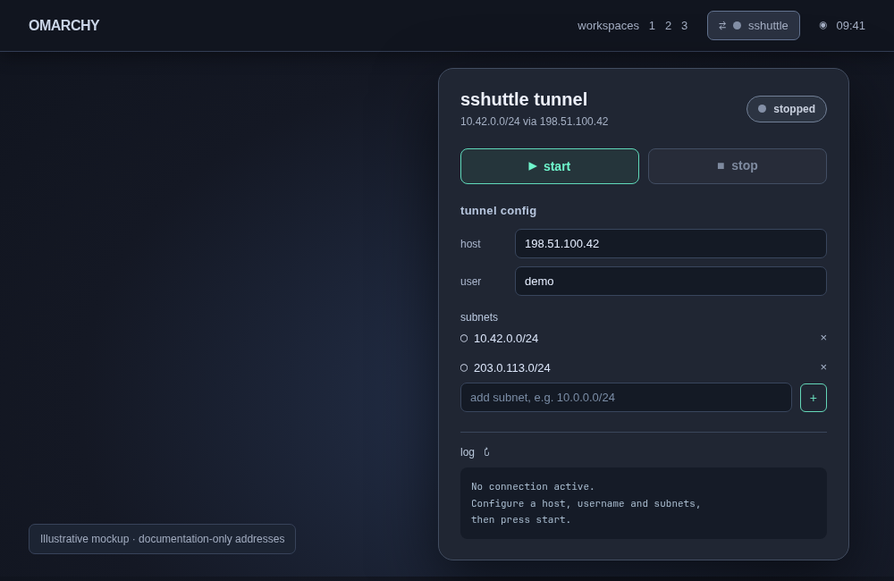
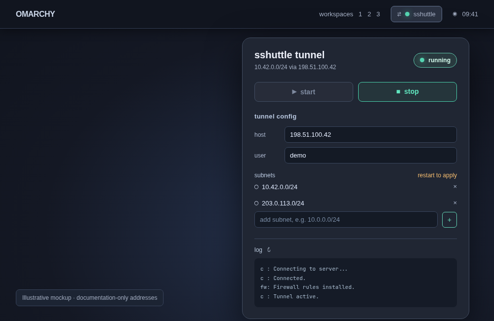

# Omarchy sshuttle


An Omarchy bar widget for controlling an [sshuttle](https://sshuttle.readthedocs.io/) tunnel. Click the bar icon to see the connection status, edit the SSH host and username, add/remove routed CIDR subnets, start/stop the tunnel, and view the log.

## Preview

These are illustrative UI mockups, not captures of a real connection. All addresses and the username are examples.

| Stopped | Running |
| --- | --- |
|  |  |

## Install

Install sshuttle and Python 3 first, then add the plugin:

```sh
omarchy plugin add <repository-url> --enable
```

Edit host, username and subnets in the panel. Configuration is stored locally in `~/.config/omarchy-sshuttle/config` and is never part of the plugin repository. Restart the tunnel after changing configuration.

Connect once from a terminal with `ssh USER@HOST` to verify the remote host key and establish key-based authentication. The plugin uses the current user's SSH agent (or `/run/user/UID/ssh-agent.socket`). SSH authentication is noninteractive, so password-only logins will not work.

Starting and stopping sshuttle requires root for firewall rules. The widget invokes `sudo` noninteractively. Configure a narrowly scoped passwordless sudo rule for the sshuttle executable and `kill`, or use the included `shuttle` CLI from a terminal where sudo can prompt for a password. Do not grant blanket passwordless sudo just for this plugin.

This plugin does not modify `/etc/hosts` or DNS. Add host entries separately if needed.

## CLI

The `shuttle` helper lives in the plugin directory:

```sh
./shuttle set host gateway.example.org
./shuttle set user remoteuser
./shuttle subnet add 10.0.0.0/24
./shuttle subnet list
./shuttle subnet del 10.0.0.0/24
./shuttle start
./shuttle status
./shuttle logs
./shuttle stop
```

Config changes take effect on the next start, not on an existing tunnel. The pidfile and log are stored in `/run/user/UID` (or `/tmp` when unavailable).

## Removal

Stop the tunnel before removing the plugin. Local settings in `~/.config/omarchy-sshuttle/` and runtime logs are not removed automatically.

## License

MIT. See [LICENSE](LICENSE).
